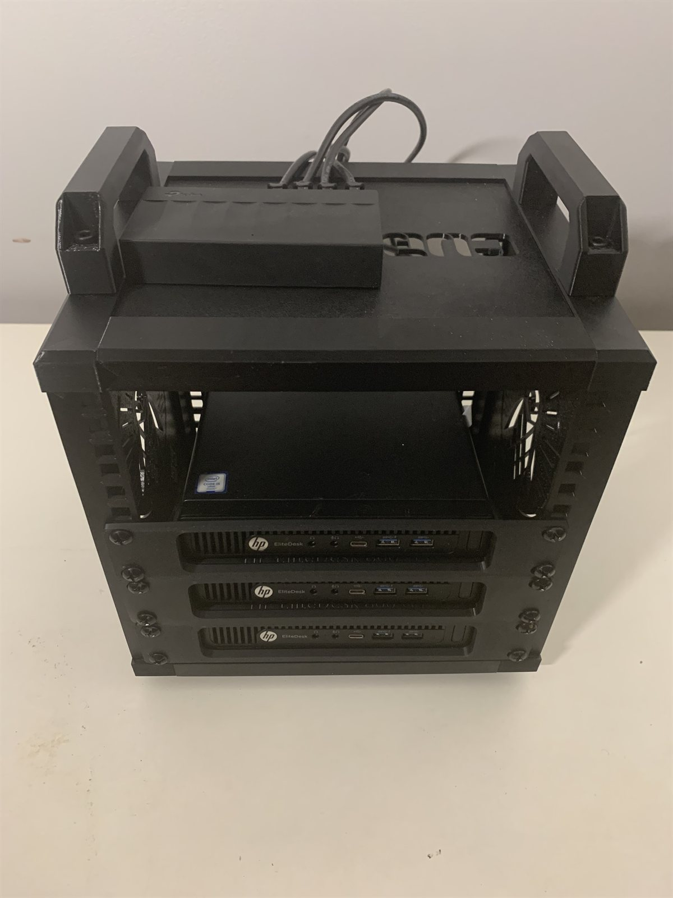
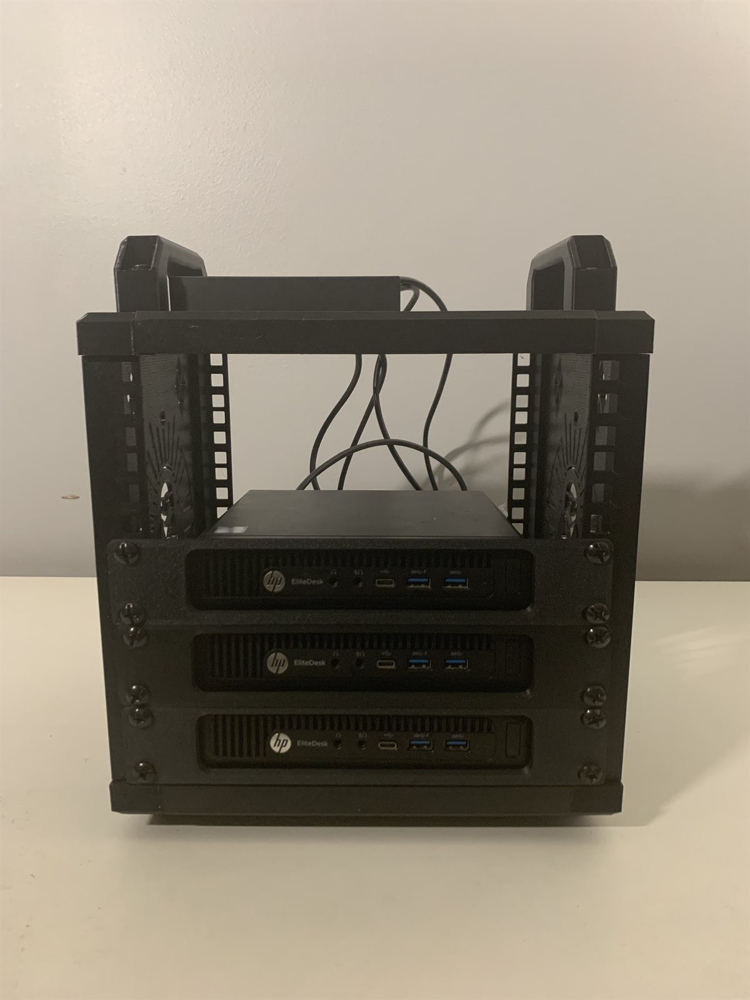
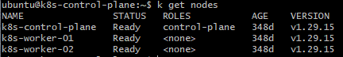

# Updates — 2026

### 2026-10: UPS added for near-zero-downtime relocation and power resilience

The August recovery below came from a long, hard disconnect, and it showed how an idle cluster can brick itself in tedious ways: dead NIC link, expired certs, swap re-enabled, IP drift. This update covers the other half of that risk: a short unplug to relocate the rack, or an unplanned power outage.

I added an **APC BN450M** (450VA battery backup and surge protector, 6 outlets) and the cluster now runs behind it. Pulling the wall plug no longer drops the nodes, and the battery carries them for several minutes, which is enough to reposition the rack or ride out a brief outage.

The install itself came out of a relocation. I unplugged the cluster briefly to move it, so the nodes did go down, and I used that window to put the UPS in line. Because they were only down for a few minutes, all three came back online cleanly, one by one, with no cert expiry, no IP drift, and no swap surprises. That's the contrast with the August outage, where the nodes had been down so long that bringing them back meant booting everything by hand and working through expired certs, swap, and IPs one layer at a time. A short outage is easy to recover from. A long one is a project. The UPS is there so future moves and brief power losses don't cause an outage at all.

Why it matters:

- **Relocation with virtually no downtime.** Unplug, move, plug back in. The nodes keep power, so there's no cold-boot recovery to babysit.
- **Power-outage resilience.** A flicker or brief grid dip no longer means a hard crash, which is exactly the kind of event that can corrupt etcd.
- **Pairs with the static-IP hardening.** The nodes are on authoritative static IPs now, so a brief network blip during a move doesn't reassign anything.

Scope: a 450VA unit is sized for a short bridge, minutes rather than hours. That's the goal here: survive a move or a brief outage, not run through a long one. The three EliteDesk minis draw little power, so the runtime headroom is comfortable for that purpose.

### 2026-10: Ingress controller benchmark (Traefik vs ingress-nginx vs Kong)

With ingress-nginx retired in March 2026, "which ingress controller do we run?" became a real question, so I answered it reproducibly on this cluster. I held everything constant (same ScopeLens app and Service, host `telecom.local`, path `/api/health`, same certificate) and changed only the controller, each on its own HTTPS NodePort: Traefik 30443, ingress-nginx 30444, Kong 30445. Each test ran as a single Kubernetes Job bundling k6 and its config, across four profiles: burst, load, soak, and stress. A request only counted if it returned HTTP 200 *and* the expected `status: ok` / `service: scopelens` body, so this measures correctness, not just reachability.

Across 12 runs, every controller finished with 0% HTTP failures and 100% of checks passing, so reliability was a tie. Kong led all four profiles on this cluster. NGINX and Traefik were close, with NGINX ahead on load and soak and Traefik ahead on burst throughput. The lesson I'd keep is to read p95 before the max: in soak, Kong's and Traefik's worst single requests were about 210 ms and 215 ms, but their p95s were 6.75 ms and 13.34 ms. These results belong to this app on this cluster. They aren't a general ranking, and the method is the useful part. All config, the app, and the results come from my home lab, not from any employer environment. Versions: Traefik 41.6.0, ingress-nginx 4.15.1, Kong 2.51.0 (Helm charts).

### 2026-08 — Cluster rebuild to 1.35

Reset all three nodes and re-initialized the cluster on Kubernetes v1.35.8 — a deliberate nuke-and-pave instead of six sequential minor upgrades from 1.29. With no valuable workloads to preserve, a clean rebuild was faster and cleaner than the long chain of staged node-upgrade operations. Calico, storage, and the worker joins were rebuilt to match.

### 2026-08 — MetalLB

Added MetalLB v0.15.2 for bare-metal `LoadBalancer` support in L2 mode, using the address pool `192.168.86.200–192.168.86.210`. The pool was chosen with the DHCP range in mind so those addresses do not overlap with dynamically assigned host addresses, closing the `LoadBalancer` limitation that motivated the whole bare-metal build.

### 2026-08 — CKS (Certified Kubernetes Security Specialist)

Passed the CKS right around the same window as the recovery below — which felt fitting, since the recovery was itself a security-and-hardening exercise. Everything the exam drills (cluster hardening, network policy, minimizing attack surface, certificate management) is exactly the kind of thing this bare-metal cluster lets you practice for real rather than in a sandbox. The last of the five, and the one this lab was most directly built for.

### 2026-08 — The 3D-printed cluster case

For a long time the lab was just bare thin clients and a switch sitting out. Eventually I gave it a proper home. I purchased a 5U 3D-printed Stackable Mini Server Homelab Rack to organize the three nodes, tidy the cabling, and add new networking hardware.






### 2026-08 — Recovery from an extended outage

After a long planned downtime — during which I installed the 3D-printed rack, a new switch, and a new power source — the cluster came back to life fighting. What I logged into wasn't one broken thing; it was four failures stacked on top of each other, and the tell that it was layered was that the error message kept *changing* as I cleared each level: `network is unreachable`, then `connection refused`, then a kubelet crash-loop, then an `x509` certificate mismatch. Each new error meant I'd fixed the layer below it.

**The four stacked failures:**

1. **Physical link was dead.** The NIC reported `NO-CARRIER` on `eno1` — a cable knocked loose during the rack rebuild. Nothing above it can work until the wire is alive.
2. **The cluster certificates had expired.** kubeadm certs have a one-year lifetime, and the cluster had been up (then down) long enough to cross it.
3. **Swap had silently re-enabled.** A reboot during the downtime re-read `/etc/fstab` and turned swap back on. The kubelet refuses to start with swap enabled, so the control plane never came up.
4. **kubeconfig endpoint mismatch.** During diagnosis a temporary secondary IP had crept in, and I initially chased the wrong address before the certificate's SAN told me which IP the cluster was actually built on.

**The recovery — worked bottom-up, physical first, application last. Never skip a layer.**

Layer 1 — restore the link:
```bash
ip a show eno1
# 2: eno1: <NO-CARRIER,BROADCAST,MULTICAST,UP> ... state DOWN
```
`NO-CARRIER` means no signal on the wire. Reseated the ethernet at both the NIC and the switch until the link light came on; the interface flipped to `state UP`.

Layer 2/3 — confirm addressing and reachability:
```bash
ip a show eno1          # confirm an inet address is present
ping -c2 192.168.86.1   # confirm the gateway is reachable
```

Renew the expired certificates:
```bash
sudo kubeadm certs check-expiration   # confirm what expired
sudo kubeadm certs renew all          # renew every control-plane cert
```

Disable swap — the real cluster-killer:
```bash
sudo swapoff -a
sudo sed -i '/swap/s/^/#/' /etc/fstab   # comment the swap line so it stays off
swapon --show                           # should print nothing
```

Restart the control plane:
```bash
sudo systemctl restart containerd kubelet
sleep 45
sudo crictl ps        # apiserver, etcd, scheduler, controller-manager Running?
```

Fix the kubeconfig endpoint — the apiserver cert is issued for a specific IP, so if `kubectl` points at a different address every call fails TLS verification even when the network is fine:
```bash
sudo cp /etc/kubernetes/admin.conf $HOME/.kube/config
sudo chown $(id -u):$(id -g) $HOME/.kube/config
kubectl get nodes
```

Recover the workers — each had the same swap problem:
```bash
ssh ubuntu@192.168.86.102
sudo swapoff -a
sudo sed -i '/swap/s/^/#/' /etc/fstab
sudo systemctl restart kubelet
```
Once the apiserver was reachable again, the worker kubelets rotated their own client certs and rejoined. All three nodes returned to `Ready` (Kubernetes v1.29.15).



**The hardening — so this specific stack can't recur:**

- **Made the static network authoritative.** cloud-init could silently reassert network config on boot, so I disabled its network management and wrote my own netplan file it won't touch:
```bash
echo 'network: {config: disabled}' | \
  sudo tee /etc/cloud/cloud.cfg.d/99-disable-network-config.cfg
```
Then an authoritative `/etc/netplan/01-static.yaml` on each node with `dhcp4: false`, pinning the control plane to `192.168.86.101/24`, worker-01 to `192.168.86.102/24`, and worker-02 to `192.168.86.103/24` — gateway `192.168.86.1`, DNS `8.8.8.8` / `8.8.4.4`.
- **Swap off permanently**, with the fstab line commented.
- **Cert-expiry monitoring is the follow-up** — the outage was the most avoidable one possible, so alerting on certificate expiry (via the planned Prometheus/Grafana stack, or a scheduled `kubeadm certs renew`) is on the roadmap.

**What it taught me, in one place:** diagnose bottom-up — layer 1, then IP, then services, always in that order. kubeadm certs expire at one year; an idle cluster will brick itself on them. A "static" config that isn't *authoritative* can silently revert. And kubelet-plus-swap is the recurring homelab gotcha that will get you every reboot if you let it. It's the best troubleshooting story the lab has produced so far.

### 2026-06 — CKAD (Certified Kubernetes Application Developer)

Passed the CKAD in June. After the cluster had sat through an extended downtime, getting back into application-workload drills — deployments, config, jobs, probes, the day-to-day developer surface of Kubernetes — was a good way to knock the rust off before the bigger recovery and hardening work later in the summer.
